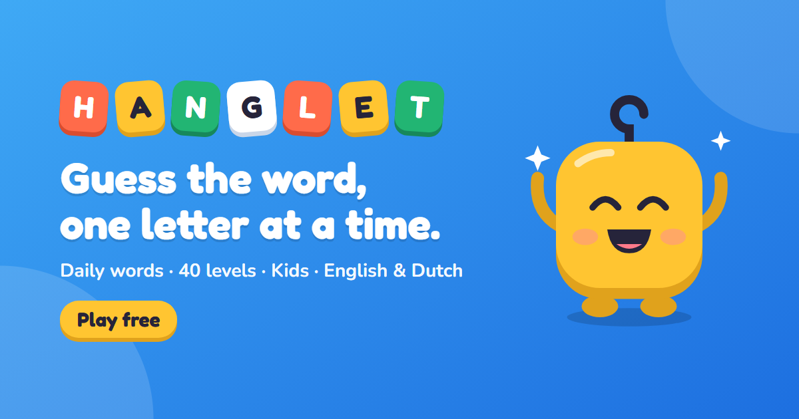

# Hanglet

🚧 Work in progress – new features are being added.

**Play it live:** <https://aisha789123.github.io/hanglet/>

**A cheerful riddle game for everyone from 8 years old, in English and Dutch.
The riddle gets clearer.**
Playful like Duolingo, but grown-ups enjoy it too. Younger kids (6–9) get their own Kids world.

**Tilo**, the little letter tile with a hook on his head, gives you a smart,
tricky clue ("I'm a spy who never leaves the garden"). Guess letters, or type the
whole word with **I know it!**. Every 2 wrong letters open a clearer clue. Solve it
at clue 1 for 3 stars, at clue 2 for 2 stars, at clue 3 for 1 star. Play three
Daily riddles (the same for everyone), endless Classic riddles, a level map with
40 levels, or challenge a friend with your own word and clues. Stars unlock
figures and color themes.

Inspired by the Codédex Python tutorial, rebuilt as a full web game.



## The core rules (all modes)

- Every word has **3 clues**: 1 = smart and tricky (wordplay, "I" form), 2 = clearer, 3 = almost the answer
- You start with clue 1. After every **2 wrong letters** the next clue opens
- **I know it!**: type the whole word. Wrong = **2 lives**. A word with the wrong length is free
- Solved at clue 1 = ⭐⭐⭐, clue 2 = ⭐⭐, clue 3 = ⭐, not solved = 0
- Difficulty (Settings or before Classic):
  - **Easy** – 8 lives and the first letter for free (the default for new players)
  - **Normal** – 7 lives
  - **Hard** – 6 lives, and clue 3 never comes
- Lose 2 words in a row and Tilo kindly offers an easier difficulty

The rules live in one place: `js/core/round.js` (clues, I know it!, stars) and
`js/core/difficulty.js` (lives, free letter, number of clues).

## Features

**Modes**
- **Daily** – 3 riddles a day (short, medium, long), the same for everyone with the same language, also during the winter season. Share text: `Hanglet #330 ⭐⭐⭐ ⭐⭐ ⭐ (6/9)`
- **Classic** – endless riddles, choose category and length
- **Levels** – 40 levels on an illustrated map, 3 to 6 riddles per level. Level stars come from the stars you earn: on average 2.5+ per riddle = 3 level stars, 1.75+ = 2, else 1. Missing one riddle fails the level
- **Kids world (6–9)** – words of 3–5 letters with a picture and 3 easy, funny clues, a small keyboard, and no losing: every wrong letter opens an easier clue and Tilo helps. No stars, but a sticker per word
- **Challenge a friend** – pick a secret word, write 1 to 3 clues, send the link (WhatsApp too). The word is scrambled in the link, no server needed

**Rewards (only stars, no coins)**
- Stars unlock 3 figures (flower 25, snowman 60, rocket 120) and 7 color themes (lagoon 10 … gold 200)
- 24 badges, for example "10 riddles at the first clue", "Daily 9/9", "100 stars". Badges from earlier versions stay visible
- **My dictionary** shows every solved word with its 3 clues; the clue where you solved it is yellow
- **Statistics**: stars per riddle, % solved at clue 1, solved per clue, streaks and a Daily calendar

**For everyone**
- English and Dutch, each with its own word list and own wordplay (not translations)
- Welcome dialog and an interactive tour
- Large text, high contrast, reduce motion, keyboard play, screen reader labels and live messages
- Installable app (PWA, manifest in English and Dutch) that works offline. A new version shows "A new version of Hanglet is ready – Refresh"
- Download your progress as a file and load it again (Settings)
- Winter look from 1 December to 6 January with an extra Winter list in Classic

**Removed in v5:** coins, buying hints, the treasure chest, daily missions, Time
Attack, XP and player levels. Old links to Time Attack open Classic.

## Words

- `data/words/en.js` and `data/words/nl.js`: 11 categories (animals, food, at home,
  nature, jobs, sports, music, clothing, science, countries, mystery) plus a winter list.
  Now 238 English and 259 Dutch words (+ 14 / 12 winter words)
- `data/kids.js`: Kids words per picture, with 3 clues per language

Add a word like this, in the right category:

```js
{ word: "giraffe", clues: [
  "I'm always the first to know when it starts to rain.",  // 1: smart, "I" form
  "I eat leaves from the tops of trees on the savanna.",    // 2: clearer
  "The animal with the longest neck.",                      // 3: almost the answer
] },
```

Rules (checked by `tests/words.test.js`): lowercase a–z only (no accents), at least
4 letters, exactly 3 different clues, the word never appears in its own clues, and
every category keeps at least 6 short (4–5), 6 medium (6–7) and 6 long (8+) words.
Clue 1 must be smart and original: wordplay or a double meaning, not a famous
internet riddle. Leave a word out rather than keep a weak riddle.
Kids words: 3–5 letters, a picture from `js/ui/pictures.js`, 3 easy clues.

## How to run

Hanglet uses JavaScript modules, so it needs a web server (double-clicking
`index.html` will not work). There is no build step.

- **Python:** `python -m http.server 8000` in this folder, then open <http://localhost:8000>
- **Node:** `npx serve` in this folder
- **VS Code:** *Live Server* → *Open with Live Server* on `index.html`

Useful while testing: `?season=winter` / `?season=off` on any page (remembered until
the tab closes). The Daily stays the same either way.

### Tests and the difficulty check

The tests use Node.js 22 or newer:

```
npm test                          # all tests in tests/
node tools/simulate.js 50 normal  # plays 50 words per language automatically
```

- `core.test.js` – clues, I know it!, stars, levels, challenge link, rewards and unlocks
- `daily.test.js` – the Daily is the same every time, never uses the winter list, also with `?season=winter`; share text
- `storage.test.js` – players from version 1 keep streaks, badges, dictionary, levels and looks; export and import
- `words.test.js`, `kids.test.js` – word list rules
- `difficulty.test.js` – Easy, Normal, Hard and the "make it easier?" offer
- `files.test.js` – English and Dutch texts match, every text key in the HTML exists, the service worker lists every file, both manifests

`tools/simulate.js` plays with three simple players: "common letters first" (never
reads the clues, a worst case), "reads the clues" (recognises the word once enough
tiles are visible: 75% with clue 1, 50% with clue 2, 25% with clue 3 – an assumption)
and "knows the word list" (a best case). It is a model, not real players.

### Publish on GitHub Pages

1. Push this folder to a GitHub repository.
2. *Settings → Pages* → *Deploy from a branch*, branch `main`, folder `/ (root)`.
3. The game is live at `https://<username>.github.io/<repository>/`.

**After changing files:** raise `CACHE_NAME` in `sw.js` (now `hanglet-v7`) and add new
files to `FILES`. `tests/files.test.js` fails when a file is missing from the list.
Players then see the "New version – Refresh" message.

### Visitor statistics (GoatCounter)

Fill in your code in `js/analytics.js` (`export const GOATCOUNTER_CODE = "your-code";`).
Leave it empty to keep statistics off. GoatCounter uses no cookies.

## Folder structure

```
word-guessing-web/
├── index.html            Home: today's Daily in the middle, then Classic, Levels, Kids
├── play.html             Game screen (?mode=daily|classic|levels|kids|challenge)
├── levels.html           Level map
├── kids.html             Kids world: start page and sticker book
├── challenge.html        Make a challenge (word + up to 3 clues)
├── badges.html           All badges (and badges from earlier versions)
├── dictionary.html       My dictionary with the 3 clues per word
├── stats.html            Statistics and Daily calendar
├── settings.html         Language, difficulty, look, figures, sound, progress file, reset
├── how-to-play.html, about.html, privacy.html, 404.html   (English + Dutch)
├── manifest.webmanifest, manifest-nl.webmanifest   App settings in English and Dutch
├── sw.js                 Service worker (offline, "new version" message)
├── css/                  base, components, pages, figures, game (game.css ends with the v5 styles)
├── data/
│   ├── i18n/en.json, nl.json   Interface text
│   ├── words/en.js, nl.js      Words with 3 clues each (incl. the Winter list)
│   └── kids.js                 Kids words + pictures + 3 easy clues
├── js/
│   ├── theme-init.js     Colors, text size, language, season and manifest before the page shows
│   ├── analytics.js      GoatCounter setup
│   ├── core/             Game logic without page code (testable in Node)
│   │   ├── round.js        One riddle: clues, I know it!, stars
│   │   ├── difficulty.js   Easy / Normal / Hard
│   │   ├── words.js        Word lists, categories, picking words
│   │   ├── daily.js        Daily words and the share line
│   │   ├── levels.js       40 levels and level stars
│   │   ├── progress.js     Stats, stars, dictionary, badges, unlocks
│   │   ├── storage.js      localStorage, migration from version 1, export/import
│   │   ├── achievements.js, figures.js, themes.js, challenge.js, kids.js, season.js
│   │   └── i18n.js, dates.js, random.js
│   ├── ui/               Shared page parts (Tilo, keyboard, figures, share card, effects, …)
│   └── pages/            One script per page
├── tests/                Tests (node --test)
├── tools/simulate.js     Plays automatically to check the difficulty
└── package.json          Only for `npm test`
```

## Privacy

No account and no cookies. All progress is saved in the browser's `localStorage`
on the player's own device; the progress file you can download stays with you.
The fonts are loaded from Google Fonts. Visitor statistics with GoatCounter are off
until you add your code.

## Credits

Inspired by the Codédex Python tutorial, rebuilt as a full web game.
